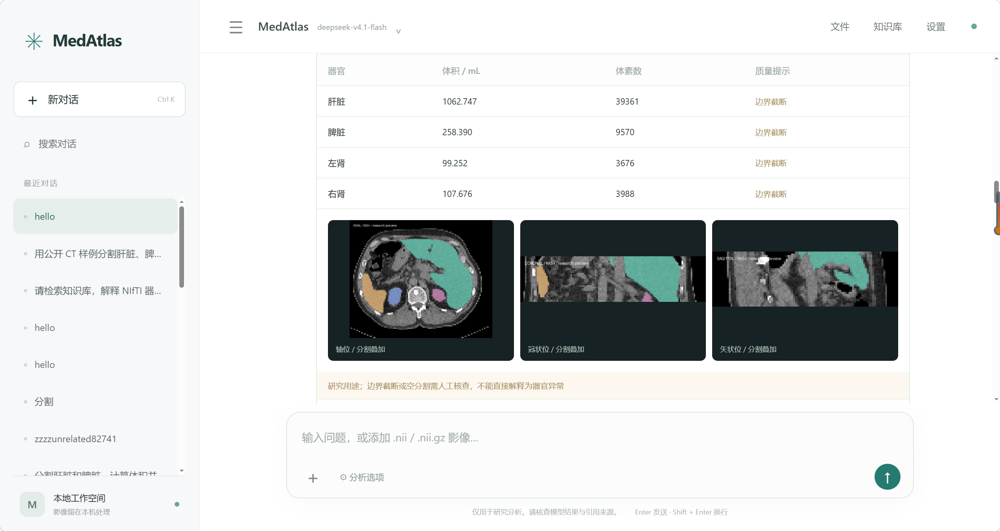
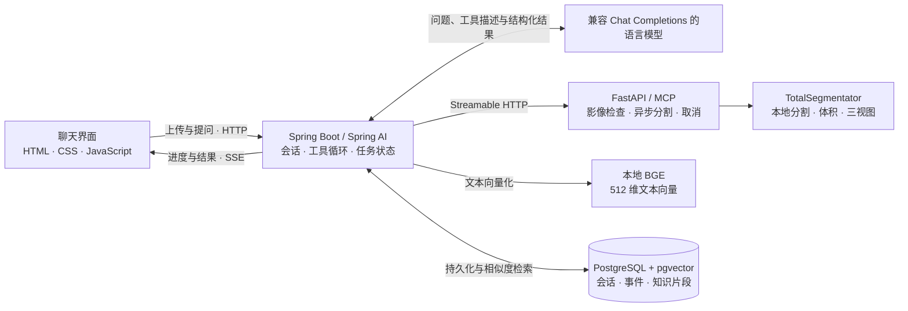

<div align="center">

# MedAtlas

**能调用三维 CT 分割工具的医学影像研究 Agent**

*Tool-using agent for 3D CT segmentation, quantitative analysis, and grounded answers.*


[实测演示](#实测演示) · [系统设计](#系统设计) · [快速开始](#快速开始) · [验证与范围](#验证与范围)

</div>

上传 `.nii` / `.nii.gz` 格式的 CT，在同一对话里完成**输入检查 → 器官分割 → 体积统计 → 资料检索与结果解释**。页面展示三视图叠加、结构化统计、来源引用，并提供掩膜与 JSON 报告下载。连续追问可复用已有推理结果。

## 实测演示



> **公开 CT 端到端验收** · `deepseek-v4.1-flash` 通过 Spring AI 依次调用影像检查、TotalSegmentator 分割和知识检索。CPU fast 分割阶段耗时 **44.03 秒**，生成 **4 份器官掩膜、3 张叠加预览和 3 条来源引用**。耗时来自一次公开小样例运行，实际速度取决于影像与硬件。

| Agent 能力 | 实现 |
|---|---|
| **工具编排** | Spring AI 显式执行多轮工具调用，服务端约束工具范围、参数、调用次数和总时限，保存任务状态与执行事件。 |
| **长任务与会话** | MCP 提交异步分割任务，支持查询和取消。SSE 推送进度并支持事件重放。追问可复用分割结果，避免重复推理。 |
| **带来源的 RAG** | 文本切分后由本地 BGE 生成 512 维向量，pgvector 做余弦相似度检索。模型获得命中片段，界面展示片段及原始来源。 |
| **影像结果可复核** | 分割统计由工具计算，校验掩膜空间一致性，标记空掩膜与扫描边界接触，并保留掩膜和预览供复核。 |

## 系统设计



**模型负责调用工具和组织回答，影像算法负责测量。** Java 端为每个任务保留模型请求轮次、工具事件与结果。影像校验、推理和掩膜保存在本机。使用在线语言模型时，用户输入、必要的结构化统计和检索文本会发往配置的服务商。

| 代码入口 | 负责什么 |
|---|---|
| [`AgentService.java`](backend/src/main/java/local/medagent/AgentService.java) | 工具循环、任务约束、会话上下文与结果复用 |
| [`ImagingClient.java`](backend/src/main/java/local/medagent/ImagingClient.java) · [`worker/app.py`](worker/app.py) | MCP 客户端与服务、NIfTI 上传、本地向量接口 |
| [`worker/service.py`](worker/service.py) · [`worker/infer.py`](worker/infer.py) | 推理队列、空间校验、量化与预览 |
| [`Knowledge.java`](backend/src/main/java/local/medagent/Knowledge.java) · [`Store.java`](backend/src/main/java/local/medagent/Store.java) | 知识入库与检索、会话和事件持久化 |
| [`Api.java`](backend/src/main/java/local/medagent/Api.java) · [`static/`](backend/src/main/resources/static/) | HTTP、SSE、结果下载与聊天界面 |

## 快速开始

需要 **Windows PowerShell、JDK 17、Maven 和 Python 3.11**。从项目目录运行。首次启动会创建 Python 虚拟环境、安装基础依赖并构建后端。

```powershell
git clone https://github.com/xuerong2024/Medical-Agent.git
cd Medical-Agent
powershell -NoProfile -ExecutionPolicy Bypass -File .\scripts\start.ps1
```

访问 [本地工作台](http://127.0.0.1:8080)，点击「先试一个样例」并发送。默认以 H2 和本地关键词检索运行。合成样例使用几何掩膜，适合验证上传、任务和页面流程，无需 API Key 或分割模型权重。

<details>
<summary><b>启用真实 CT 分割</b></summary>

```powershell
powershell -NoProfile -ExecutionPolicy Bypass -File .\scripts\install-model.ps1
```

安装完成后重启服务，上传三维 CT NIfTI（空间单位为 `mm`），选择器官并发送。也可在服务运行时执行以下命令，脚本会准备 TotalSegmentator 的公开测试影像并验证分割产物。

```powershell
.\.venv\Scripts\python.exe .\scripts\real_smoke_test.py
```

</details>

<details>
<summary><b>启用本地 PostgreSQL + pgvector</b></summary>

```powershell
powershell -NoProfile -ExecutionPolicy Bypass -File .\scripts\install-rag.ps1
```

脚本准备项目独立的 PostgreSQL 和 BGE 权重。重启后，在顶部「知识库」点击「重建向量索引」，即可检索内置的公开技术摘要。已有 H2 历史需要单独迁移。也可按 [`compose.yml`](compose.yml) 启动数据库，并按 [`.env.example`](.env.example) 配置数据库与向量服务。

</details>

<details>
<summary><b>启用 Spring AI 在线工具调用</b></summary>

在本机从 [`.env.example`](.env.example) 创建 `.env`（已存在时直接编辑），填写 `LLM_API_KEY`、`LLM_BASE_URL` 和 `LLM_MODEL`。模板对应千问按量付费接口及 `deepseek-v4.1-flash`。更换服务商时需要匹配它的接口地址、密钥和支持工具调用的模型。`LLM_DISABLE_THINKING` 按服务商对 `enable_thinking` 的支持配置。

重启后通过「设置 → 测试大模型连接」验证，再用公开 CT 试一次完整对话。

</details>

<details>
<summary><b>停止、重启与检查</b></summary>

```powershell
powershell -NoProfile -ExecutionPolicy Bypass -File .\scripts\stop.ps1
powershell -NoProfile -ExecutionPolicy Bypass -File .\scripts\start.ps1 -Build
powershell -NoProfile -ExecutionPolicy Bypass -File .\scripts\check.ps1
```

</details>

## 验证与范围

- **集成验证**覆盖真实在线工具调用、公开 CT 分割、pgvector 相似度检索、连续追问及会话恢复。构建检查包含 7 项 Java 和 6 项 Python 测试。见[验证记录](docs/验收说明.md)。
- **当前范围**为单机研究演示，支持 CT 肝脏、脾脏及双肾分割。样例上的边界提示用于提醒可见范围内的测量可能不完整。尚无临床或跨中心精度评估。
- **项目定位**是工具型影像 Agent。三维影像由 TotalSegmentator 处理，语言模型使用工具结果和知识片段回答。现有流程用于研究，不用于临床诊断。

上游项目：[TotalSegmentator](https://github.com/wasserth/TotalSegmentator) · [Spring AI](https://github.com/spring-projects/spring-ai) · [MCP Python SDK](https://github.com/modelcontextprotocol/python-sdk) · [BGE 中文模型](https://huggingface.co/BAAI/bge-small-zh-v1.5) · [pgvector](https://github.com/pgvector/pgvector)
