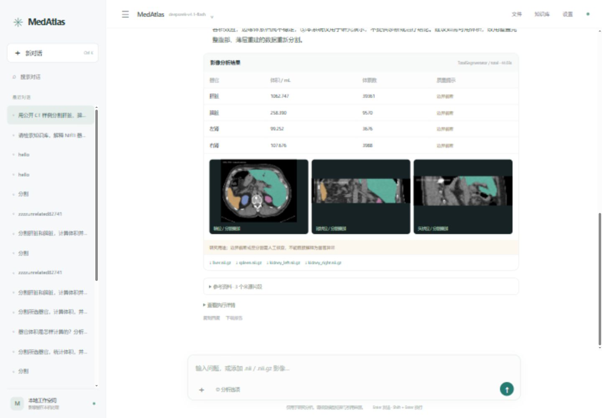

# MedAtlas 验证记录

记录日期：2026-11-13。以下结果来自本地集成验证，可通过仓库中的测试与启动脚本复现相应流程。

## 公开 CT 端到端验证

| 项目 | 实测 |
|---|---|
| 输入 | TotalSegmentator 官方公开小型 CT 测试影像，`122 × 101 × 30`，间距 `3 × 3 × 3 mm` |
| 编排 | Spring AI 1.1.2 + `deepseek-v4.1-flash`，通过千问兼容接口完成四轮模型请求与三次工具调用 |
| 推理 | TotalSegmentator 2.11.0，`total`，CPU fast；分割阶段耗时 44.03 秒 |
| 检索 | PostgreSQL 18.6 + pgvector 0.8.6 + 本地 BGE 中文模型，返回 3 条知识片段 |
| 输出 | 四器官体积统计、4 份 NIfTI 掩膜、3 张叠加预览、带引用的回复及 JSON 报告 |

公开测试文件未标记空间单位。验证脚本制作毫米单位版本，保留像素和 affine，并写入本地来源记录。样例的四个器官掩膜均触及影像边界，体积只反映可见扫描范围。该次实测用于确认链路可运行，没有标注对照或临床精度结论。输入样例来源见 [TotalSegmentator 测试影像](https://github.com/wasserth/TotalSegmentator/blob/master/tests/reference_files/example_ct_sm.nii.gz)。

## 检查项目

| 检查 | 已验证行为 |
|---|---|
| Java，7 项 | Spring AI 工具请求与响应、未注册工具拒绝、会话迁移与检索边界 |
| Python，6 项 | NIfTI 上传、影像校验、合成掩膜、幂等性、排队取消与 MCP 协议 |
| HTTP 集成 | 工具发现、SSE、结果下载、同会话追问复用、合成与真实推理隔离 |
| pgvector | 512 维向量持久化，相关查询命中，无关测试查询过滤 |
| 界面 | 样例提交、连续追问、恢复会话、顶部知识库检索和结果预览 |

启动服务后运行 [`scripts/check.ps1`](../scripts/check.ps1) 执行常规检查。安装分割权重后，运行 [`scripts/real_smoke_test.py`](../scripts/real_smoke_test.py) 验证公开 CT 的本地推理与产物。在线 Agent 实测可按 [README](../README.md) 配置接口，再在页面上传公开 CT 发起分析。Python 和 Java 单元测试无需调用在线模型。

